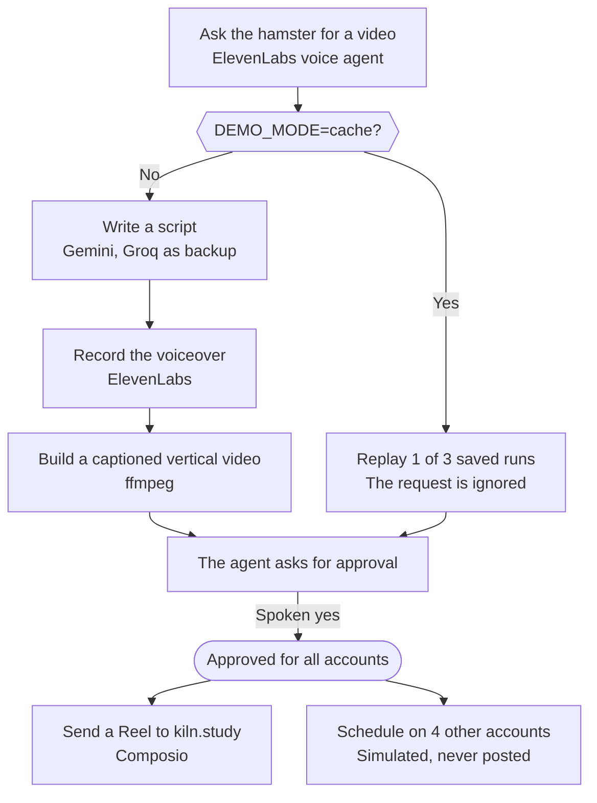

<div align="center">


# MyLittleHamster

**Call a hamster. Ask for a video. Approve it out loud.**

The AI growth coworker for Kiln, a made-up AI study app
that turns lecture notes into flashcards and quizzes.

[](package.json)
[](frontend/package.json)
[](frontend/package.json)

[**Open the app**](https://y-cx-elevenlabs.vercel.app) ·
[Backend API](https://ycxelevenlabs.onrender.com) (try [`/accounts`](https://ycxelevenlabs.onrender.com/accounts)) ·
[Run locally](#run-locally)

Built at YC x ElevenLabs, Waterloo

</div>

---

The CEO calls a hamster mascot, asks for a UGC video and approves it by voice.
The backend then sends it to Instagram as a Reel.

> [!NOTE]
> Demo videos are pre-rendered, and only kiln.study can post for real. See [Honest status](#honest-status).

## How it works



- **Script:** grounded in 22 viral UGC transcripts, then rewritten twice.
- **Video:** captions over photos downloaded from Pinterest.
- **Approval:** spoken to the agent.

## Honest status

- Demo videos are pre-rendered for speed: `DEMO_MODE=cache` replays 3 saved pipeline runs and ignores the request.
- Without that setting, the full pipeline runs. If every script model fails, it can use one of 2 saved scripts.
- Only kiln.study can post for real. It shows up in the app only after a post succeeds.
- If that post fails, the error is only logged and the app still says "Scheduled".
- The other 4 accounts are simulated and never posted to. Their schedule is simulated too.
- Best-time-to-post analytics are made-up sample data.
- Jobs and the schedule live in memory, so a backend restart clears them.

## Tech stack

**Partner tools used**

| Tool | What it does here |
| :--- | :--- |
| **ElevenLabs** | Voice agent and voiceover |
| **Composio** | Instagram posting |
| **Gemini** | Script writing |
| **Groq** | Backup script writing |

**Built with**

| Layer | Technology |
| :--- | :--- |
| Frontend | Next.js, React, TypeScript |
| Backend | Node.js, Express, TypeScript |
| Video | ffmpeg |

## Run locally

You need Node 20.12 or newer. ffmpeg is installed by npm.

### 1. Backend

From the repo root:

```bash
npm install && cp .env.example .env
```

In `.env`, set `DEMO_TOOL_SECRET`, `GEMINI_API_KEY`, `GROQ_API_KEY` and `ELEVENLABS_API_KEY`. Then start it on port 3000:

```bash
npm run dev
```

### 2. Frontend

In a second terminal, from the repo root:

```bash
cd frontend && npm install && cp .env.example .env.local
```

In `.env.local`, set `NEXT_PUBLIC_ELEVENLABS_AGENT_ID`, and set `NEXT_PUBLIC_USE_MOCK` to `false` to use the backend.
Then start it on port 3001:

```bash
npm run dev
```

### 3. Voice agent

Its tools need a public HTTPS backend URL and the same `DEMO_TOOL_SECRET`, saved in ElevenLabs.

### 4. Real posting (optional)

Add `COMPOSIO_API_KEY` (not in `.env.example`) and set `PUBLIC_BASE_URL` to a public HTTPS URL.

> [!WARNING]
> With both set, approving a new job for all accounts publishes to Instagram.

<details>
<summary><b>Optional settings</b></summary>

| Variable | Where | Purpose |
| :--- | :--- | :--- |
| `DEMO_MODE` | Backend | `cache` replays the saved runs |
| `SCRIPT_MODELS` | Backend | Script models, in fallback order |
| `ELEVENLABS_VOICE_ID` | Backend | Voiceover voice |
| `VIDEO_SIZE` | Backend | 9:16 video size, `720x1280` by default |
| `PORT` | Backend | Server port, `3000` by default |
| `BACKEND_URL` | Frontend | Backend that `/api` forwards to |

</details>

## Team

| Shahmeer | Artin | Dhanika |
| :---: | :---: | :---: |
| Backend | Backend | Frontend |
